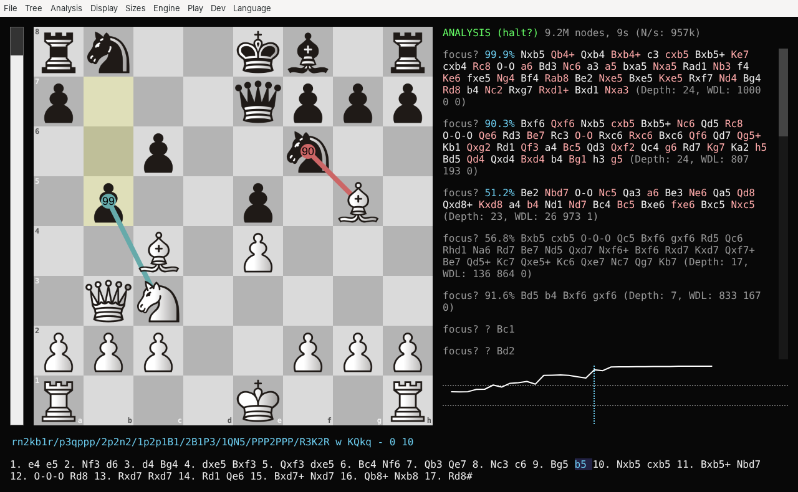
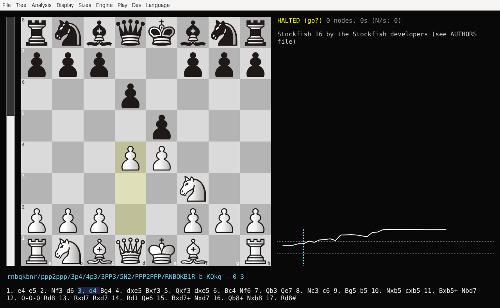
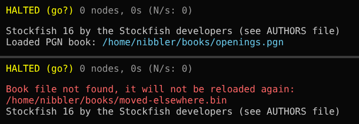

# Nibbler, le fork de deuza

[English](README.md) | **Français**

Ce dépôt est un fork maintenu de [rooklift/nibbler](https://github.com/rooklift/nibbler), l'interface d'analyse en temps réel pour Leela Chess Zero (Lc0) et pour les moteurs classiques comme Stockfish.

Vous y retrouvez le même Nibbler, avec les mêmes menus, les mêmes raccourcis clavier et les mêmes fichiers de réglages, avec en plus :

* un **Electron à jour** : 44.11.5, alors que les versions officielles embarquent toujours Electron 9.4.4, qui n'est plus maintenu depuis mars 2021 ;
* une **barre d'évaluation** à côté de l'échiquier ;
* les **coordonnées** sur l'échiquier ;
* des **évaluations qui survivent à l'enregistrement et à la réouverture d'un PGN** (`[%eval]`) ;
* le **livre d'ouverture rechargé au démarrage** ;
* deux **corrections de l'export PGN** ;
* des **versions vérifiables** : archives construites de façon reproductible, avec des sommes de contrôle signées par la clé OpenPGP du mainteneur.

**Toutes les nouvelles fonctionnalités sont optionnelles et désactivées par défaut.** À l'installation, ce fork a l'apparence et le comportement du Nibbler officiel : vous activez depuis les menus ce qui vous intéresse, et rien d'autre ne change.



*Stockfish 16 analyse la partie de l'Opéra (Morphy, Paris 1858) après 9...b5, avec la barre d'évaluation et les coordonnées activées. Le graphique a été rempli à partir des commentaires `[%eval]` du fichier PGN.*

## Un Electron à jour

Nibbler est une application Electron : Electron embarque le moteur de navigateur Chromium et l'environnement Node.js qui font tourner tout le programme. Les versions officielles pour Windows et Linux sont toujours construites avec Electron 9.4.4 (voir `files/scripts/builder.py` du dépôt officiel), et le script d'installation officiel pour macOS utilise Electron 41.0.3, dont le support a pris fin le 24 août 2026.

| | Nibbler officiel (Windows, Linux) | Ce fork |
| --- | --- | --- |
| Electron | 9.4.4 | 44.11.5 |
| Chromium | 83.0.4103.122 | 152.0.7977.169 |
| Node.js | 12.14.1 | 24.22.3 |
| Support | [terminé le 3 mars 2021](https://releases.electronjs.org/release/v9.4.4) | Branche Electron 44 [maintenue jusqu'au 2 mars 2027](https://endoflife.date/electron) |

Electron 9 ne reçoit plus aucune correction, y compris de sécurité. Dans ce fork, `builder.py` construit les versions Windows et Linux avec Electron 44.11.5. Cette version a été testée sous Windows 11, Debian Trixie et macOS sur Apple Silicon, analyse avec Lc0 comprise.

Electron 44 demande un système 64 bits (x64 ou arm64), macOS 13 (Ventura) ou plus récent ([notes de version d'Electron 44](https://electronjs.org/blog/electron-44-0)), et Windows 10 ou plus récent ([Electron et Windows 7/8/8.1](https://electronjs.org/blog/windows-7-to-8-1-deprecation-notice)).

## Fonctionnalités optionnelles

Elles sont toutes désactivées par défaut. Chacune correspond à une simple case à cocher dans un menu, enregistrée dans `config.json` comme n'importe quel autre réglage de Nibbler. Les menus de Nibbler sont en anglais, d'où les libellés ci-dessous.

| Fonctionnalité | Où l'activer | Clé de `config.json` |
| --- | --- | --- |
| Barre d'évaluation | Display > Evaluation bar | `eval_bar` |
| Coordonnées | Display > Coordinates | `coordinates` |
| `[%eval]` dans le PGN enregistré, relu à l'ouverture | File > PGN saved statistics > [%eval] (restored on load) | `pgn_eval_command` |
| Livre d'ouverture rechargé au démarrage | Play > Reload book at startup | `book_reload_at_startup` |

### Barre d'évaluation

Une barre verticale, à gauche de l'échiquier, affiche l'évaluation de la position en cours : c'est la même valeur que celle du graphique, elle suit donc le moteur pendant qu'il calcule, et elle affiche aussi les évaluations lues dans un fichier PGN. La part des Blancs remplit la barre par le bas, ou par le haut quand l'échiquier est retourné. Une position qui n'a pas encore d'évaluation affiche des rayures grises. La largeur de la barre suit la taille des cases.

### Coordonnées

Les colonnes sont indiquées le long du bord inférieur et les rangées le long du bord gauche, dans le coin des cases : 16 étiquettes discrètes, colorées pour rester lisibles sur les cases claires comme sur les sombres. Elles suivent l'échiquier quand vous le retournez, et elles sont dessinées au-dessus des pièces et des surbrillances, si bien que leur aspect ne dépend pas du camp qui a le trait. Elles ne gênent jamais le déplacement d'une pièce à la souris.

### Évaluations conservées dans le PGN (`[%eval]`)

Par défaut, les évaluations calculées par Nibbler sont perdues dès que vous le fermez. Avec cette option, chaque coup enregistré reçoit une commande `[%eval]` dans son commentaire, du point de vue des Blancs, en pions (`#N` ou `#-N` pour un mat forcé) :

```text
1. e4 {[%eval 0.36]} 1... e5 {[%eval 0.35]} 2. Nf3 {[%eval 0.37]} 2... d6 {[%eval 0.59]}
```

Quand vous ouvrez un fichier PGN avec l'option activée, ces valeurs reviennent sur le graphique et sur la barre d'évaluation, sans lancer le moteur. Dès que le moteur analyse de nouveau une position, sa propre évaluation prend le relais. Une valeur lue dans le fichier et non retouchée depuis est réécrite à l'identique au prochain enregistrement. Les autres statistiques PGN (EV, CP, N, WDL...) fonctionnent comme avant et peuvent être combinées avec elle.



*Le moteur est arrêté : le graphique et la barre proviennent tous deux des commentaires `[%eval]` du fichier.*

### Livre d'ouverture rechargé au démarrage

Nibbler oublie le livre d'ouverture à chaque fermeture. Avec cette option, le dernier livre chargé avec succès, Polyglot ou PGN, est rechargé au démarrage. Les chargements de livre sont désormais inscrits dans le journal, et si le fichier a été déplacé ou supprimé, Nibbler l'indique en rouge et cesse de le chercher.



## Corrections de l'export PGN

Il s'agit de corrections de bugs et non de fonctionnalités : elles sont donc toujours actives. Elles ne modifient que le texte PGN que Nibbler enregistre ou copie dans le presse-papiers ; la liste des coups affichée à l'écran n'est pas concernée.

**Numéro des coups noirs après une variante ou un commentaire** (issue #100 du dépôt officiel). Le standard PGN (section 8.2.2.2) veut qu'un coup noir porte son numéro quand une variante ou un commentaire le sépare du coup blanc précédent. Nibbler l'omettait :

```text
Avant :  2. c3 (2. d3 a6) d5           1. e4 {EV: 55.5%} c6
Après :  2. c3 (2. d3 a6) 2... d5      1. e4 {EV: 55.5%} 1... c6
```

**Statistiques des coups que le moteur n'a jamais signalés** (issue #274 du dépôt officiel). Un moteur comme Stockfish ne signale que ses lignes MultiPV (3 par défaut) : un coup joué en dehors de ces lignes n'avait aucun commentaire dans le PGN enregistré, alors que le graphique affichait bien une valeur. Ces coups reçoivent désormais leurs statistiques (EV, CP, WDL, profondeur, selon ce qui est coché dans le menu) depuis l'analyse de la position à laquelle ils mènent, c'est-à-dire exactement ce qu'affiche le graphique. Les coups que le moteur a signalés sont écrits comme avant.

## Où en est le dépôt officiel

Tout ce qui précède a été proposé au projet officiel sous forme de pull requests, chacune testée sous Windows 11, Debian et macOS. Au 23 novembre 2026 :

| Pull request | Objet | État dans le dépôt officiel |
| --- | --- | --- |
| [#295](https://github.com/rooklift/nibbler/pull/295) | Coordonnées | Ouverte : retravaillée à la demande du mainteneur, sans réponse depuis |
| [#299](https://github.com/rooklift/nibbler/pull/299) | Electron 44 sur toutes les plateformes (désormais 44.11.5) | Ouverte, aucune revue |
| [#301](https://github.com/rooklift/nibbler/pull/301) | Livre d'ouverture rechargé au démarrage | Ouverte, aucune revue |
| [#302](https://github.com/rooklift/nibbler/pull/302) | `[%eval]` dans le PGN enregistré | Ouverte, aucune revue |
| [#303](https://github.com/rooklift/nibbler/pull/303) | Barre d'évaluation | Ouverte, aucune revue |
| [#305](https://github.com/rooklift/nibbler/pull/305) | Numéros des coups noirs dans le PGN (corrige #100) | Ouverte, aucune revue |
| [#306](https://github.com/rooklift/nibbler/pull/306) | Statistiques PGN manquantes (corrige #274) | Ouverte, aucune revue |

Deux contributions de ce fork ont déjà été fusionnées dans le dépôt officiel, et sont bien sûr présentes ici : la sélection de plusieurs dossiers Syzygy à la fois (#296), et la correction de l'erreur "Object has been destroyed" à la fermeture (#304).

Le fork suit le dépôt officiel : chaque modification apportée au Nibbler officiel est également fusionnée ici.

## Installation

Les archives sont jointes à chaque version, dans la section Releases de ce dépôt. Pour la version 3.0.0 :

* **Windows** : `nibbler-3.0.0-windows.zip`. Extrayez-la où vous voulez et lancez `nibbler.exe`.
* **Linux** : `nibbler-3.0.0-linux.tar.gz`. Extrayez-la avec `tar -xzf nibbler-3.0.0-linux.tar.gz` et lancez `nibbler-3.0.0-linux/nibbler`. Vous pouvez aussi lancer `bash files/scripts/install.sh` depuis un clone de ce dépôt : il télécharge la dernière version, la vérifie contre la liste signée des sommes de contrôle de la version, et l'installe dans `/opt/nibbler` avec une entrée de menu (il demande `sudo`).
* **macOS** : il n'y a pas d'application prête à l'emploi, car macOS bloque une application non signée téléchargée telle quelle. `bash files/scripts/install_mac.sh`, lancé depuis un clone de ce dépôt, construit `Nibbler.app` sur votre Mac à partir des sources de la version et de l'Electron officiel, dont il vérifie l'archive contre la liste des sommes de contrôle d'Electron.

Le fork utilise le même dossier de réglages que le Nibbler officiel : vos fichiers `config.json` et `engines.json` existants (moteurs, réseaux, options) sont repris tels quels.

Pour le lancer directement depuis les sources, installez Electron 44.11.5 (par exemple `npm install -g electron@44.11.5`), puis lancez `electron .` dans `files/src`.

## Vérifier une version

Ne faites pas confiance, vérifiez. Chaque version est accompagnée de `SHA256SUMS`, la liste des sommes de contrôle de ses archives, et de `SHA256SUMS.asc`, la signature de cette liste par la clé OpenPGP du mainteneur :

```text
root@deuza.net
F04C 74F3 6625 0DE2 A309  1E46 A91A D62A 5CB8 9279
```

C'est aussi la clé qui signe les commits et les tags de ce dépôt. Elle est publiée dans le Web Key Directory de deuza.net. Dans le dossier où vous avez téléchargé les fichiers de la version :

```bash
gpg --auto-key-locate clear,wkd,nodefault --locate-external-keys root@deuza.net
gpg --verify SHA256SUMS.asc SHA256SUMS
sha256sum -c --ignore-missing SHA256SUMS
```

`gpg --verify` doit annoncer une signature valide de `root@deuza.net`, faite par la clé dont l'empreinte figure ci-dessus, et `sha256sum` doit afficher `OK` pour l'archive que vous avez téléchargée. Sous Windows, `Get-FileHash nibbler-3.0.0-windows.zip -Algorithm SHA256` dans PowerShell donne la somme à comparer avec la ligne de `SHA256SUMS`, et Gpg4win fournit `gpg`.

## Construire votre propre version

Vous n'êtes pas non plus obligé de croire les archives sur parole : vous pouvez les construire vous-même, à partir du tag signé, et comparer.

```bash
git clone https://github.com/deuza/nibbler.git
cd nibbler
git verify-tag v3.0.0
git checkout v3.0.0
sh files/scripts/release.sh
```

`git verify-tag` vérifie que le tag a été signé par la clé ci-dessus. `files/scripts/release.sh` ensuite :

* télécharge les archives officielles d'Electron indiquées dans `files/scripts/builder.py`, et les vérifie contre la liste des sommes de contrôle d'Electron ;
* refuse de construire si `files/src` ou `files/res` diffèrent en quoi que ce soit du commit ;
* lance `builder.py`, puis crée les archives et leur `SHA256SUMS` dans `files/scripts/dist`, avec toutes les dates fixées à celle du commit et des droits, un ordre des fichiers et des propriétaires normalisés.

Construites avec les mêmes outils (GNU tar, gzip et zip d'Info-ZIP), vos archives sont identiques aux archives publiées, octet pour octet : les deux fichiers `SHA256SUMS` sont donc identiques eux aussi. Si vos versions de ces outils produisent une archive différente, comparez plutôt les contenus, qui doivent être identiques quels que soient les outils :

```bash
mkdir publiee locale
tar -xzf /chemin/vers/nibbler-3.0.0-linux.tar.gz -C publiee
tar -xzf files/scripts/dist/nibbler-3.0.0-linux.tar.gz -C locale
diff -r publiee locale && echo "Contenus identiques"
```

Le script a besoin de `git`, `curl`, `sha256sum`, `python3`, `zip`, de GNU `tar` et de `gzip` ; il est écrit pour un shell POSIX et a été utilisé sous Debian et Ubuntu.

## Crédits

Nibbler est écrit par [rooklift](https://github.com/rooklift/nibbler) et publié sous licence GPL-3.0, tout comme ce fork. Les ajouts de ce fork sont de DeuZa.

Les captures d'écran montrent Stockfish 16 sur la partie de l'Opéra, Paul Morphy contre le duc de Brunswick et le comte Isouard, Paris 1858.

La documentation d'origine du projet (en anglais) se trouve à la suite de la présentation du fork, dans [README.md](README.md).
