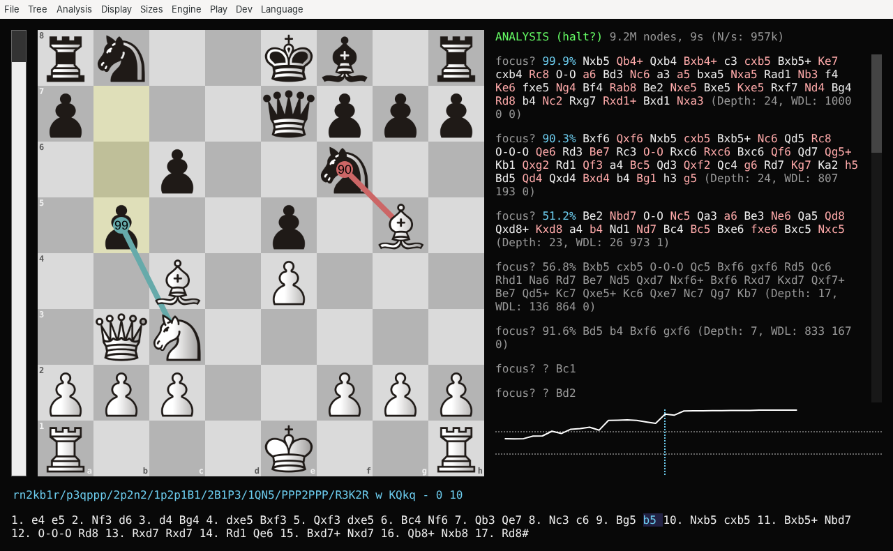
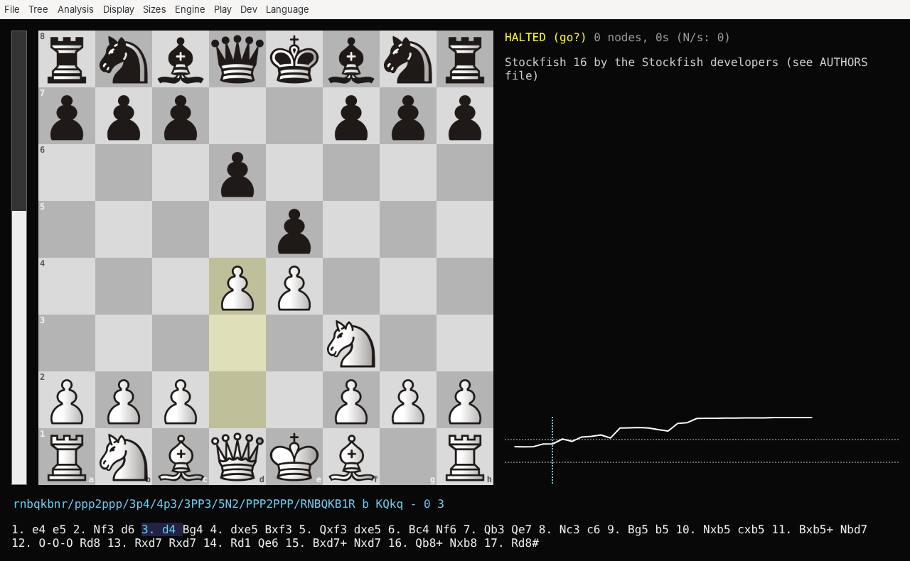
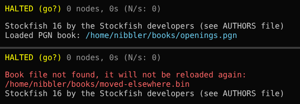

# Nibbler, deuza's fork

**English** | [Français](README.fr.md)

This is a maintained fork of [rooklift/nibbler](https://github.com/rooklift/nibbler), the real-time analysis GUI for Leela Chess Zero (Lc0) and for traditional engines such as Stockfish.

It is the same Nibbler, with the same menus, keyboard shortcuts and settings files, plus:

* a **current Electron**: 44.7.0, where the official builds still ship Electron 9.4.4, out of support since March 2021;
* an **evaluation bar** next to the board;
* **board coordinates**;
* **evaluations that survive saving and reopening a PGN** (`[%eval]`);
* the **opening book reloaded at startup**;
* two **fixes to the PGN export**.

**Every new feature is optional and off by default.** Out of the box, this fork looks and behaves like the official Nibbler: you switch on what you want from the menus, and nothing else changes.



*Stockfish 16 analysing the Opera Game (Morphy, Paris 1858) after 9...b5, with the evaluation bar and the coordinates switched on. The graph was filled from the `[%eval]` comments of the PGN file.*

## A current Electron

Nibbler is an Electron application: Electron bundles the Chromium browser engine and the Node.js runtime that run the whole program. The official Windows and Linux builds are still made with Electron 9.4.4 (see `files/scripts/builder.py` upstream), and the official macOS install script uses Electron 41.0.3, whose support ended on 24 August 2026.

| | Official Nibbler (Windows, Linux) | This fork |
| --- | --- | --- |
| Electron | 9.4.4 | 44.7.0 |
| Chromium | 83.0.4103.122 | 152.0.7977.130 |
| Node.js | 12.14.1 | 24.21.0 |
| Support | [ended on 3 March 2021](https://releases.electronjs.org/release/v9.4.4) | Electron 44 line [supported until 2 March 2027](https://endoflife.date/electron) |

Electron 9 no longer receives any fix, security fixes included. In this fork, `builder.py` builds the Windows and Linux versions with Electron 44.7.0. This version has been tested on Windows 11, Debian Trixie and macOS on Apple Silicon, analysis with Lc0 included.

Electron 44 needs a 64-bit system (x64 or arm64), macOS 13 (Ventura) or later ([Electron 44 release notes](https://electronjs.org/blog/electron-44-0)), and Windows 10 or later ([Electron and Windows 7/8/8.1](https://electronjs.org/blog/windows-7-to-8-1-deprecation-notice)).

## Optional features

All of them are off by default. Each one is a single menu checkbox, saved in `config.json` like any other Nibbler setting.

| Feature | Where to switch it on | `config.json` key |
| --- | --- | --- |
| Evaluation bar | Display > Evaluation bar | `eval_bar` |
| Board coordinates | Display > Coordinates | `coordinates` |
| `[%eval]` in saved PGN, read back on load | File > PGN saved statistics > [%eval] (restored on load) | `pgn_eval_command` |
| Opening book reloaded at startup | Play > Reload book at startup | `book_reload_at_startup` |

### Evaluation bar

A vertical bar on the left of the board shows the evaluation of the current position: it is the same value as the graph, so it follows the engine while it thinks, and it also shows the evaluations read from a PGN file. White's share fills the bar from the bottom, or from the top when the board is flipped. A position with no evaluation yet shows grey stripes. The width of the bar follows the size of the squares.

### Board coordinates

Files are written along the bottom edge and ranks up the left edge, in the corner of the squares: 16 discreet labels, coloured to stay readable on light and dark squares. They follow the board when it is flipped, and they are drawn above the pieces and the highlights, so they look the same whoever is to move. They never get in the way of dragging a piece.

### Evaluations kept in the PGN (`[%eval]`)

By default, the evaluations Nibbler computes are lost once you close it. With this option, each saved move gets a `[%eval]` command in its comment, from White's point of view, in pawns (`#N` or `#-N` for a forced mate):

```text
1. e4 {[%eval 0.36]} 1... e5 {[%eval 0.35]} 2. Nf3 {[%eval 0.37]} 2... d6 {[%eval 0.59]}
```

When you open a PGN file with the option on, these values go back onto the graph and the evaluation bar, without running the engine. As soon as the engine analyses a position again, its own evaluation takes over. A value read from the file and not touched since is written back unchanged on the next save. The other PGN statistics (EV, CP, N, WDL...) work as before and can be combined with it.



*The engine is halted: the graph and the bar both come from the `[%eval]` comments of the file.*

### Opening book reloaded at startup

Nibbler forgets the opening book every time it closes. With this option, the last book that loaded successfully, Polyglot or PGN, is loaded again at startup. Book loads are now written to the log, and if the file has been moved or deleted, Nibbler says so in red and stops trying.



## PGN export fixes

These two are bug fixes rather than features, so they are always active. They only change the PGN text that Nibbler saves or copies to the clipboard; the move list on screen is not affected.

**Black move numbers after a variation or a comment** (upstream issue #100). The PGN standard (section 8.2.2.2) wants a Black move to carry its move number when a variation or a comment comes between it and the previous White move. Nibbler left it out:

```text
Before:  2. c3 (2. d3 a6) d5           1. e4 {EV: 55.5%} c6
After:   2. c3 (2. d3 a6) 2... d5      1. e4 {EV: 55.5%} 1... c6
```

**Statistics for moves the engine never reported** (upstream issue #274). An engine like Stockfish only reports its MultiPV lines (3 by default), so a move played outside them got no comment at all in the saved PGN, even though the graph showed a value for it. Such moves now get their statistics (EV, CP, WDL, depth, as selected in the menu) from the analysis of the position they lead to, which is exactly what the graph displays. Moves the engine did report are written as before.

## Status upstream

Everything here has been offered to the official project as pull requests, each one tested on Windows 11, Debian and macOS. As of 23 November 2026:

| Pull request | Subject | Status upstream |
| --- | --- | --- |
| [#295](https://github.com/rooklift/nibbler/pull/295) | Board coordinates | Open: reworked as the maintainer asked, no answer since |
| [#299](https://github.com/rooklift/nibbler/pull/299) | Electron 44.7.0 on all platforms | Open, no review |
| [#301](https://github.com/rooklift/nibbler/pull/301) | Opening book reloaded at startup | Open, no review |
| [#302](https://github.com/rooklift/nibbler/pull/302) | `[%eval]` in saved PGN | Open, no review |
| [#303](https://github.com/rooklift/nibbler/pull/303) | Evaluation bar | Open, no review |
| [#305](https://github.com/rooklift/nibbler/pull/305) | Black move numbers in PGN (fixes #100) | Open, no review |
| [#306](https://github.com/rooklift/nibbler/pull/306) | Missing PGN statistics (fixes #274) | Open, no review |

Two contributions from this fork have already been merged upstream, and are of course included here: several Syzygy folders at once (#296), and a fix for the "Object has been destroyed" error on quit (#304).

The fork follows upstream: every change made to the official Nibbler is merged here as well.

## Installation

Prebuilt packages for Windows, Linux and macOS will be published in the Releases section of this repository.

Meanwhile, you can run it from source. Install Electron 44.7.0 (for instance `npm install -g electron@44.7.0`), then:

```bash
git clone https://github.com/deuza/nibbler.git
cd nibbler/files/src
electron .
```

To build a standalone version, see the comments in `files/scripts/builder.py`.

The fork uses the same settings folder as the official Nibbler, so your existing `config.json` and `engines.json` (engines, weights, options) are picked up as they are.

## Credits

Nibbler is written by [rooklift](https://github.com/rooklift/nibbler) and released under the GPL-3.0 licence, like this fork. The additions of this fork are by DeuZa.

The screenshots show Stockfish 16 on the Opera Game, Paul Morphy against the Duke of Brunswick and Count Isouard, Paris 1858.

---

*The text below is the official README, unchanged. Its links and its install one-liners point to the official repository and install the official version, not this fork.*

---

# Nibbler

Nibbler is a real-time analysis GUI for [Leela Chess Zero](http://lczero.org/play/quickstart/) (Lc0), which runs Leela in the background and constantly displays opinions about the current position. You can also compel the engine to evaluate one or more specific moves. Nibbler is loosely inspired by [Lizzie](https://github.com/featurecat/lizzie) and [Sabaki](https://github.com/SabakiHQ/Sabaki).

These days, Nibbler more-or-less works with traditional engines like [Stockfish](https://stockfishchess.org/), too. (Ensure `MultiPV` is `1`, `Threads` (CPU) is set, and `Hash` is set (more is better), for maximum strength.)

For prebuilt binary releases, see the [Releases](https://github.com/rooklift/nibbler/releases) section. For help, the [Discord](https://discordapp.com/invite/pKujYxD) may be your best bet, or open an issue here.


## Features

* Display Leela's top choices graphically.
* Winrate graph.
* Optionally shows Leela statistics like N, P, Q, S, U, V, and WDL for each move.
* UCI `searchmoves` functionality.
* Automatic full-game analysis.
* Play against Leela from any position.
* Leela self-play from any position.
* PGN loading via menu, clipboard, or drag-and-drop.
* Supports PGN variations of arbitrary depth.
* FEN loading.
* Chess 960.

## Installation - Windows / Linux

Some Windows and Linux standalone releases are uploaded to the [Releases](https://github.com/rooklift/nibbler/releases) section from time to time.

*Alternatively*, it is possible to run Nibbler from source. This requires Electron, but has no other dependencies. If you have Electron installed (e.g. `npm install -g electron`) you can likely enter the `/src` directory, then do `electron .` to run it. Nibbler should be compatible with at least version 5 and above.

You could also build a standalone app. See comments inside the Python script `builder.py` for info.

## Linux install script

Linux users can make use of the following *one-liner* to install the latest version of Nibbler:

```bash
curl -L https://raw.githubusercontent.com/rooklift/nibbler/master/files/scripts/install.sh | bash
```

## Installation - Mac

Mac builds have been made by [twoplan](https://github.com/twoplan/Nibbler-for-macOS) and [Jac-Zac](https://github.com/Jac-Zac/Nibbler_MacOS) and [Zamana](https://github.com/Zamana/nibbler) - the last of which is probably the most up-to-date.

## Mac install script

Alternatively, MacOS users can run the following *one-liner* to assemble Nibbler locally. This (hopefully) removes any codesigning issues (Gatekeeper refusing to open unauthorized apps) by building Nibbler on-the-fly, though I can't test it myself:

```bash
curl -L https://raw.githubusercontent.com/rooklift/nibbler/master/files/scripts/install_mac.sh | bash
```

## Advanced engine options

Most people won't need them, but all of Leela's engine options can be set in two ways:

* Leela automatically loads options from a file called `lc0.config` at startup - see [here](https://lczero.org/play/configuration/flags/#config-file).
* Nibbler will send UCI options specified in Nibbler's own `engines.json` file (which you can find via the Dev menu).

## Hints and tips

An option to enable the UCI `searchmoves` feature is available in the Analysis menu. Once enabled, one or more moves can be specified as moves to focus on; Leela will ignore other moves. This is useful when you think Leela isn't giving a certain move enough attention.

Leela forgets much of the evaluation if the position changes. To mitigate this, an option in the Analysis menu allows you to hover over a PV (on the right) and see it play out on the board, without changing the position we're actually analysing. You might prefer to halt Leela while doing this, so that the PVs don't change while you're looking at them.

Leela running out of RAM can be a problem if searches go on too long. You might like to set a reasonable node limit (in the Engine menu), perhaps 10 million or so.

## Thanks

Thanks to everyone in Discord and GitHub who's offered advice and suggestions; and thanks to all Lc0 devs and GPU-hours contributors!

The pieces are from [Lichess](https://lichess.org/).

Icon design by [ciriousjoker](https://github.com/ciriousjoker) based on [this](https://www.svgrepo.com/svg/155301/chess).
